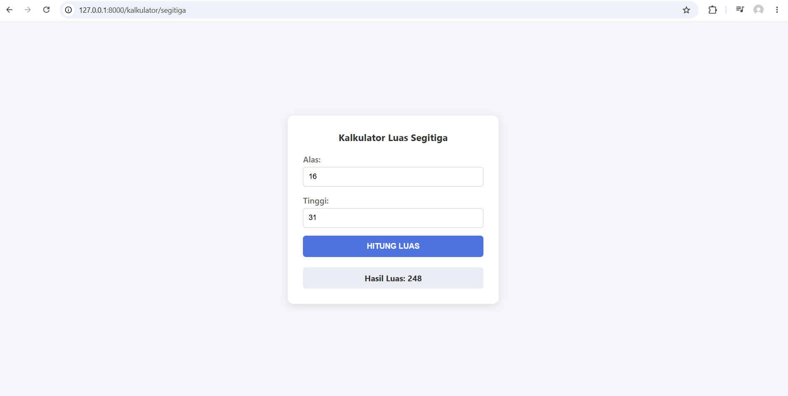
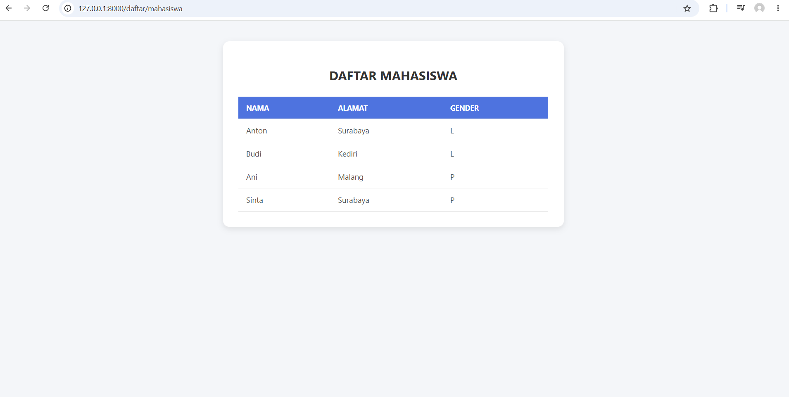

# Laporan Praktikum Laravel - Tugas Halaman 12

Repositori ini dibuat untuk menyelesaikan tugas praktikum Pemrograman Web menggunakan **Laravel**, yang mencakup pembuatan Controller, routing, parsing data, serta styling CSS.

## Teknologi yang Digunakan

- **PHP** (Versi 8.x)
- **Laravel Framework**
- **HTML5 & CSS3** (Custom Styling)
- **Visual Studio Code**
- **Git & GitHub**

## Daftar Tugas & Fitur

### 1. Daftar Mahasiswa (`MahasiswaController`)

Menampilkan daftar mahasiswa menggunakan teknik parsing data dari Controller ke View, diakses melalui URL `/daftar/mahasiswa`.

Data mahasiswa:
- Anton - Surabaya (L)
- Budi - Kediri (L)
- Ani - Malang (P)
- Sinta - Surabaya (P)

### 2. Kalkulator Luas Segitiga (`KalkulatorController`)

Fitur kalkulator berbasis web untuk menghitung luas segitiga berdasarkan input alas dan tinggi, diakses melalui URL `/kalkulator/segitiga`.

## Tampilan Hasil (Screenshot)

### Tampilan Kalkulator Segitiga



### Tampilan Daftar Mahasiswa



## Cara Menjalankan Project

1. Buka folder repository di Visual Studio Code.
2. Masuk ke folder proyek Laravel:

   ```powershell
   cd web-app
   ```

3. Jalankan server lokal Laravel:

   ```bash
   php artisan serve
   ```

4. Buka alamat yang muncul di terminal, biasanya `http://127.0.0.1:8000`.

---

**Catatan:** Seluruh kode program Laravel berada di dalam folder `web-app`, sedangkan dokumentasi dan screenshot berada di root repository.